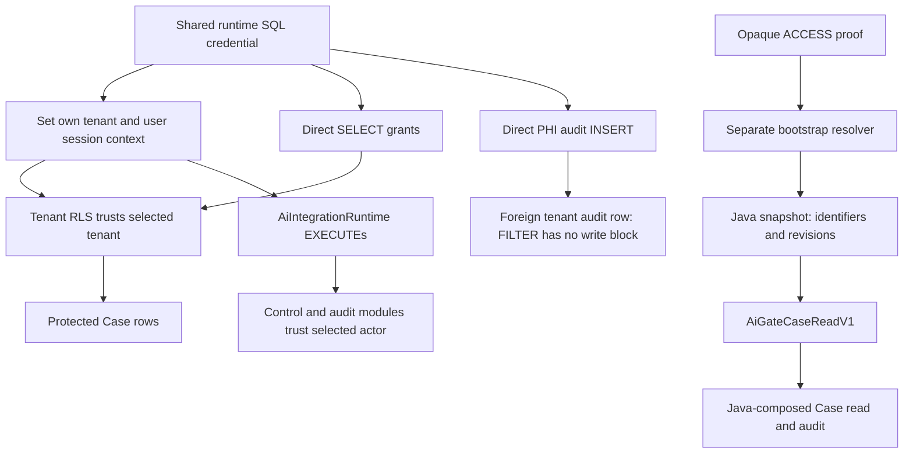

# Phase 3B.7 SQL confinement: blocked remediation review

Classification: **BLOCKED**. This review does not remediate either SQL permission failure.
The two failures recorded by [merged PR #1919](https://github.com/gseshadow/Shale/pull/1919)
remain open; aggregate 3B.7 remains **FAILED**, and Phase 3B remains IN PROGRESS.
The serving expiry failure and the broader acceptance matrix are outside this task.

Review base: `99bfec0458cfa690235397dfb57d36fb45e97d0f`, fetched current
`origin/codex/latest` on 2026-10-25. Isolated branch: `codex/phase3b7-sql-confinement`.
The original checkout and unrelated work are preserved. No production code, SQL,
MCP tool/schema, dependency, activation default or historical migration changes here.

## Why this cannot be classified FIXED

SQL Server permits **ordinary users to set their own session context**. Microsoft documents
that any user can set context for their own session in
[sp_set_session_context](https://learn.microsoft.com/en-us/sql/relational-databases/system-stored-procedures/sp-set-session-context-transact-sql).
The shared SQL credential is therefore an identity-selection credential wherever the database
trusts those values. Checking that Java arguments match the values that Java just wrote proves
consistency, not authenticated identity. No hidden ID, UUID, extra equality check or admin flag
changes that fact.

Two prerequisites prevent a verified implementation in this execution:

1. The current application-composed shared Case worker must be replaced or extended with a
   database-authenticated protected operation. The recommended decision below changes the
   internal authority/proof lifetime, SQL procedure boundary and AI pool composition together.
   Merely creating another login with the existing role and grants is still bypassable. This is
   a larger architecture contract change than an RLS/grant correction; its concrete design is
   presented for review here, not represented as an installed solution.
2. The authoritative source and both derived/candidate files from #1919 are **absent from this
   environment**. The recorded source path does not exist. The source's expected hash is
   `4ac397b0eef874b319d60be043fd0fa27c5ec30ac45e3b807a791ced37243eda` (728,862 bytes);
   derived hash `6e571b96915e6b80436898b664a516c3782caddec78efca13336cc08bcaab290`;
   candidate hash `621e8013f417108e556e056723ec9d4e424d66632e5e0ace5fd23a4a9f4e331d`.
   None was recomputed here. The guarded Case launcher refused before credentials/SQL.
   Reconstructing a schema from documentation or a synthetic fixture would not satisfy the
   requested authoritative reproduction. #1919's SQL results are historical evidence only.

## Authority inventory at the review base

This inventory distinguishes source configuration and #1919's disposable principal from deployed
authority. No production catalog or credential was accessed. The exact generated login from #1919
was cleaned up; no persistent login name or production role inventory can be inferred from it.

| Boundary | Current authority and evidence |
| --- | --- |
| Ordinary runtime login | `Config.rtUser()` resolves `SHALE_RT_DB_USER` / `SHALE_RT_USER`; URL and password use their existing RT settings. The actual configured value is not inspected. `DataSources.runtime()` owns one lazy Hikari pool reused by ordinary application and MCP composition. `shale_runtime` is a convention, not verified deployment evidence. |
| #1919 runtime login/user | `AuthoritativeCaseMcpLocalSqlServerTest.setup` creates `AiOAuth_<random>_runtime`, matching database user, member of `AiIntegrationRuntime`. No sysadmin, db_owner, ShaleAdmins or AiCapabilityOperator membership; explicit denial probes in `permissions`. |
| Direct SELECT in that fixture | Object-level SELECT on `dbo.Cases`, `Users`, `CaseUsers`, `CaseStatuses`, `Statuses`, `PracticeAreas`, `UserSessions`, `ShaleClients`. These are whole-table grants, not the eight-field projection. The AI migration role itself does not grant these reads. |
| Direct PHI INSERT | Object-level INSERT on `dbo.auditLog` to that user. `AuditLogDao.appendPhiWriteAudit(Connection,...)` executes a direct INSERT, taking tenant from session context and actor from its argument. No database-validated invocation proof is supplied. |
| AI tables | Direct SELECT/INSERT/UPDATE/DELETE/ALTER/CONTROL denials on all 14 AI/control/access-audit tables for runtime/bootstrap as established by accumulated migrations. Static same-owner procedure access is separate from direct grants. |
| Global control | Only `AiCapabilityOperator` has the two global capability EXECUTEs. Ordinary runtime is not an operator. The role is not an application `Users.is_admin` flag. |
| Bootstrap | Separate configured OAuth bootstrap SQL identity, role `AiIntegrationBootstrap`; owner-executed bounded resolvers listed below. No runtime resolver EXECUTE is granted. It returns provisional references, not a protected Case result. |
| Session initialization | `RuntimeSessionService.getConnection(int)` borrows, writes `ShaleClientId`, then `PrincipalUserId`, without `@read_only=1`; closes on either setup failure. `clear()` clears Java fields, not SQL context. `IntegrationRuntimeLease` uses a fresh initializer per acquisition, closes abandoned leases and bounds setup. |
| MCP composition | `McpTransportConfiguration.mcpAccessAuthenticator`, `McpSearchConfiguration` and `McpOverviewConfiguration` all obtain `DataSources.runtime()`, including failure-audit connections. There is no distinct AI runtime principal/pool configuration. |
| ACCESS proof lifetime | `AiAccessTokenValidator.validate` hashes the opaque ACCESS, passes the digest to `ResolveAiAccessV1`, then zeroes it. `VerifiedIntegrationContext` retains only IDs/revisions/scopes/deadline. `AiAccessContractTest` explicitly forbids credential bytes in that snapshot. |
| Case RLS | Exact exported `sec.fn_FilterByTenant` permits dbo, ShaleAdmins, or tenant equality with mutable `SESSION_CONTEXT`. Cases are tenant filtered; user context is not an authenticated SQL user binding. Application `verifyMinimizedActor` checks active/nonremoved same-tenant Users and equality with both keys. Case-root predicates and joined tenant checks remain necessary but do not confine the SQL credential. |
| PHI RLS | #1919 candidate adds a strict tenant FILTER to `auditLog`, with no INSERT/UPDATE BLOCK. FILTER controls visibility/targeting; it does not reject a newly inserted tenant-B row under A context. |
| Gate | `AiGateCaseReadV1` executes as caller in exactly one caller transaction. It validates complete durable lineage, scope/revisions/expiry/reservation with held locks and database UTC. Tenant/user come from session context; its credential/integration/grant/session/invocation arguments are references, not proof of possession. It does not mediate direct table SELECT or INSERT. |
| PHI transaction | `IntegrationCaseReadService` gates, invokes the connection-bound shared worker, verifies a PHI count delta of one for Overview, appends integration parent/resources, gates, commits and closes. It then encodes and takes a fresh final gate. Direct SQL can skip all these Java steps. |

The complete current source EXECUTE allowlists follow. These grants are to roles, not proof of
production membership. Helpers reachable through module ownership chains are not direct runtime grants.

| Role | Direct EXECUTE grants in the accumulated AI migrations |
| --- | --- |
| `AiIntegrationRuntime`, foundation | `AiGetTenantPolicyV1`, `AiInspectKeysV1`, `AiSetTenantPolicyV1`, `AiRegisterIntegrationV1`, `AiChangeIntegrationV1`, `AiRotateClientKeyV1`, `AiRevokeClientKeyV1`, `AiBeginConsentV1`, `AiAcceptConsentV1`, `AiRevokeGrantV1`, `AiRevokeSessionV1`, `AiInspectRegistrationsV1`, `AiVerifySessionV1`, `AiReserveQuotaV1`, `AiReleaseQuotaV1` |
| `AiIntegrationRuntime`, OAuth | `AiLoadOAuthClientV1`, `AiBeginOAuthV1`, `AiFindOAuthIntentV1`, `AiApproveOAuthV1`, `AiCompleteOAuthV1`, `AiDenyOAuthV1`, `AiConsumeOAuthCodeV1`, `AiExchangeOAuthCodeV1`, `AiIssueCredentialsV1`, `AiRefreshCredentialsV1`, `AiLoadRevocationClientV1`, `AiRevokeOAuthCredentialV1`, `AiValidateAccessV1` |
| `AiIntegrationRuntime`, disclosure | `AiGateCaseReadV1`, `AiAppendCaseAccessV1`, `AiFinishCaseQuotaV1`, `AiReviewCaseAccessV1`, `AiOverviewPhiCountV1`, `AiAccountCaseAttemptV1` |
| `AiIntegrationBootstrap` | `ResolveAiClientV1`, `ResolveAiCredentialV1`, `ResolveAiOAuthCodeV1`, `ResolveAiRefreshV1`, `ResolveAiRevocationV1`, `ResolveAiAccessV1` |
| `AiCapabilityOperator` | `AiSetProductCapabilityV1`, `AiGetProductCapabilityV1` |

`sp_set_session_context` is used by the shared initializer, bootstrap owner resolvers' bounded
setup/restoration, ordinary request/desktop providers and the SQL fixtures. No integration/grant
context key exists. A pooled connection carries no independently authenticated integration authority.

## Explicit authority graph

The direct SELECT/INSERT edges bypass the gate. Denying AI-table DML does not remove the
control-module edge. Adding the old role to a new AI login reproduces all three problems.

## Design evaluation

| Design | Assessment and tradeoffs |
| --- | --- |
| A: immutable session context | Rejected as a standalone fix. An ordinary SQL caller can set B first and make B read-only; immutability authenticates no initial value. SQL Server documents read-only scope as the logical connection, and MARS restricts setting a key read-only while multiple batches are active; values have batch visibility rules. Hikari's logical close does not itself prove a SQL Server logical reset. Current pooling intentionally reuses a physical session across A1/A2/B1/A1. A solution would need a database-authenticated initializer, pinned driver/reset behavior and actual MARS/reborrow/fault tests. No such safety or operational proof was executed here. Even a guaranteed pool reset would not authenticate the first value. See [SESSION_CONTEXT](https://learn.microsoft.com/en-us/sql/t-sql/functions/session-context-transact-sql). |
| B: procedure-only protected access | Recommended with independently validated proof. Remove direct protected-table reads and PHI INSERT from the AI principal. A complete narrow read procedure must validate proof, derive tenant/actor, read the bounded projection and append required PHI/integration history atomically. A procedure that just accepts tenant/user/credential row IDs repeats the flaw. A separate gate followed by caller SELECT also repeats it. Existing shared Java SQL workers cannot operate with those direct grants removed. |
| C: separate AI principal | Required with B to preserve ordinary Shale. Use an independently configured AI data pool/principal with a new role and no membership in AiIntegrationRuntime, bootstrap, operator, fixed reader/writer or bypass roles. Sharing the ordinary pool defeats this separation. Ordinary WEB/DESKTOP/REST providers and trusted SQL model stay unchanged. Principal separation by itself, retaining direct grants/context-trusting procedures, fails. |
| D: database-bound identities or signed capabilities | Per-user SQL logins mapped durably to tenant/user could enforce identity independently of context but require provisioning, routing, rotation and separate pools at user scale; a per-tenant login alone does not confine user identity. A signed invocation capability from a separate authority can work, but introduces a signer, key custody/rotation and replay/deadline lifecycle. The AI SQL principal must never mint or rebind that proof. A durable row addressed only by a UUID or bigint is not proof. |

## Recommended architecture decision, not implemented

Choose **B + C**, with the existing opaque ACCESS credential as the cryptographic proof rather
than inventing another signing authority. The database already stores its SHA-256 digest and durable
lineage. The recommended internal contract must retain a narrowly scoped proof holder through the
invocation and validate proof inside **every** exposed AI data/accounting procedure. Identifiers remain
lookup references only. No MCP input, output, tool or scope changes are needed.

This supersedes the current proof-discarding contract, not the immutable identity snapshot: keep the
snapshot free of credentials and introduce a separate, non-loggable, explicitly closed proof lifetime.
The raw ACCESS proof should be hashed inside SQL and compared to stored credential state; do not make
credential IDs, resolver output or stored digest read access sufficient. Proof must never enter SQL
text, errors, audit, DTOs, logs or serialization. SQL parameters and the separate holder need a reviewed
memory/diagnostic lifetime. Failure history after revocation needs retained **authenticated** ownership
without restoring read authority; expired/revoked proof may identify retained owners only for bounded
failure/accounting operations. It must never authorize an ALLOWED_READ.

The protected operation must:

1. Authenticate ACCESS proof with exact configured issuer/resource and durable lineage; derive tenant,
   user, integration, grant and session. Reject any supplied tuple mismatch, missing proof, malformed
   proof or unavailable authority before a protected query. Never fall back to shared runtime.
2. Establish derived context only for existing strict RLS, revalidate full live authority with the
   existing lock order/database UTC, and execute the canonical minimized Case query inside the same
   protected module. Preserve filtering, literal search, paging/probe bounds and eight fields. The
   ownership-chain/signing design must confer only necessary table authority; no general dbo execution
   can be exposed. Executing as owner requires explicit review of the existing dbo RLS bypass.
3. On Overview, derive PHI tenant/actor and Case identity from the authorized result, insert exactly
   the existing event and verify persistence, append integration parent/child, and commit atomically.
   Any failure withholds output. No public generic append procedure accepts arbitrary tenant/actor.
4. Require proof for separate quota, failure-audit and final-handoff operations too. Preserve durable
   admission/no refunds, retained failure ownership and post-commit live handoff checks. The existing
   broad tenant-admin, consent, key, issuer, audit-review and control procedures are not callable by
   this data principal, even through another granted procedure or impersonation route.
5. Use independent AI pool configuration and fail closed if it is absent or resolves to ordinary,
   bootstrap/operator/bypass authority. Validate effective permissions including public/nested roles,
   ownership, column grants, synonyms/views and module execution chains. A name comparison is insufficient.

The integration path currently reuses the Java `selectMinimized` worker. Moving protected SQL behind
the new boundary must establish one canonical query/projection implementation with reviewed ordinary
delegation/parity; copying the Case SQL into a new procedure and letting it drift is not accepted here.
This transaction/query ownership and proof-lifetime change is the larger architecture decision required
before implementation, rather than a claim that permission tweaks resolve the existing design.

| Authority | Before (#1919) | Proposed AI principal | Actual after this review |
| --- | --- | --- | --- |
| Direct Case/join SELECT | Eight table grants listed above | None; no view/column/module bypass | Unchanged |
| Direct PHI audit INSERT | Granted | Denied; protected Overview owns append | Unchanged |
| Existing AiIntegrationRuntime EXECUTEs | Full allowlist above | None; new proof-validating data/accounting allowlist only | Unchanged |
| Bootstrap/global/control/admin review | Separate roles; runtime has tenant controls/review | None on AI data principal | Unchanged |
| Session context writes | Caller-selected | Still mutable, but cannot confer authority or unlock direct data | Still bypassable today |

## Independent PHI write boundary

A strict `auditLog` AFTER INSERT BLOCK using the existing tenant predicate would reject the
specific A-stamped/B-row INSERT, but a caller can stamp B first and then insert B. It also does not
bind `userId` to an authenticated actor. Therefore BLOCK alone cannot satisfy both requested properties.
Applying it broadly needs historical writer/nullable-actor/admin compatibility review; this review
does not silently alter ordinary audit writers or the shared predicate.

For the recommended AI boundary, remove direct INSERT and derive the existing PHI fields inside
the protected Overview transaction from the database-authenticated invocation/result. This keeps
legitimate Overview audit insertion atomic while denying A proof plus B tenant, actor or Case even
after arbitrary context writes. Audit history/control tables also remain inaccessible to direct DML.
No new event vocabulary, PHI payload, audit schema, asynchronous audit or best-effort path is proposed.

## Migration and rollback requirements for the implementation

No migration is included or executed by this blocked review. Historical receipt hashes and semantics
remain unchanged. The implementation requires a **new** additive reviewed AI/security migration after
`phase3b3.sql`, transactional and repeat-safe, with cumulative source/catalog drift receipts and exact
schema/function/owner/predicate/grant prerequisites. Unexpected or unreceipted objects must abort before
DDL. New role creation must not silently inherit old-role access. Manual provisioning of the distinct
login and pool secrets is separate from schema installation; no startup installer or automatic grants.

Verification must enumerate effective authority as the actual AI SQL login, not dbo impersonation,
and run the matrix below on the hash-gated authoritative candidate. Repeating the migration/verifier
must pass unchanged; missing dependencies, changed query/procedure bodies, expanded grants, disabled
triggers/policies and wrong ownership must fail and leave no partial install.

Operational rollback is AI capability/transport OFF, revoke the new principal's access, close its
pools, and retain all history/receipts. Do not restore shared runtime grants or fall back to ordinary
credentials as a rollback. Reverting application code alone cannot safely revert this boundary.
No destructive down migration or production SQL is authorized by this document.

## Required adversarial proof: all unresolved for a new design

| Required case | #1919 / source evidence | This execution |
| --- | --- | --- |
| A/A to B/B context then B Case read | ALLOWED in #1919 actual runtime probe | NOT RUN; no authoritative input |
| Change only tenant | Tenant-only Case RLS cannot authenticate actor; application checks are separate | NOT RUN |
| Change only user | Same-tenant actor selection remains caller-controlled | NOT RUN |
| Clear/reapply context | No immutable/database-authenticated session binding | NOT RUN |
| B PHI INSERT under A authority | ALLOWED in #1919, transaction rolled back | NOT RUN |
| Direct bypass of Case boundary | Direct table SELECT bypasses Java gate/audit | NOT RUN |
| Direct integration audit/control changes | #1919 direct DML denied; granted context-trusting modules remain separate authority | NOT RUN |
| Existing denials | #1919 AI/control SELECT, integration/entity/global audit INSERT, global control EXECUTE, bootstrap EXECUTE, dbo impersonation and policy ALTER denied | Historical evidence retained, no new SQL claim |
| A search, A Overview, required audit | #1919 authoritative core/Case harness pass | Application regressions only; no authoritative SQL pass |
| Pooled A1/A2/B1/A1 and failed setup/reborrow | #1919 authoritative harness pass for existing model | Application regressions only; new confinement pool behavior unverified |

The implementation's negative tests must use real distinct non-bypass SQL logins and both A and B
valid proofs. Possession of the AI SQL credential alone, random/known IDs, A proof plus B IDs, A proof
plus all context mutations, missing/expired/revoked proof and forged/replayed invocation state must not
read B or attribute B audit history. A proof must not execute control-plane, issuer or admin procedures.
Positive cases must retain one Overview PHI append and same-transaction integration audit, test rollback
on actual DENY/suppressing trigger, and prove safe physical-session reuse, failed setup, late acquisition,
MARS behavior if supported and clean reborrow. Do not weaken #1919's assertions or resume its expiry drill.

## Verification and test impact

Related tests inspected before edits: `IntegrationCaseReadTest`, `AiAccessContractTest`, the existing
AI SQL fixture/authority tests, the complete #1919 `permissions` method, Case importer/safety harness,
CaseSummaryDao contracts, MCP search/Overview tests and ordinary request/session/OAuth contracts.
No behavioral expectation was superseded and no test was weakened. This change is documentation only;
passing existing application tests cannot validate the proposed SQL boundary.

Commands, counts and execution limits are recorded in
[phase3b7-sql-confinement-verification.json](phase3b7-sql-confinement-verification.json).
The historical [3B.7 receipt](phase3b7-verification.json) is unchanged.

No production/Azure SQL, production deployment, real tenant/integration enablement, installer/version
publication or aggregate acceptance occurred. Both requested runtime vulnerabilities remain unresolved.
